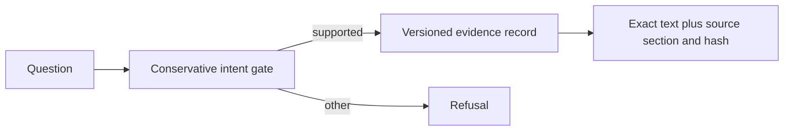

> **Proprietary - All Rights Reserved.** Licensed to Sandeep Grover. No reuse, copying, modification, or distribution without prior written permission. See LICENSE.

# LeverUp documentation evidence demonstrator

A proposal demonstrator by Dr. Sandeep Grover, not a delivered LeverUp product. It runs locally without API keys. It deliberately implements only two documented intents and refuses everything else, so it cannot be mistaken for a full RAG assistant. No wallets, trading, private keys or client data.



## Run
```bash
pip install -r requirements.txt
python main.py "What is the maximum leverage?"
python -m pytest -q
```

## Evidence and boundaries
The two short authored paraphrases in data/leverup_facts.json were checked against the public Welcome to LeverUp page on 22 October 2026. They are a bounded demonstration snapshot. The full documentation, client PDF and private records are not redistributed. All Acme documents in the inherited grounding tests are fictional.

The additional rag_starter modules implement cleaning, BM25, chunking, abstention and evaluation. The optional generator guard accepts only exact extracts with valid citations; citation membership alone cannot establish factual support. There is no LLM in the demo run. The published paid prototype would add full allowed-source ingestion, hybrid retrieval, an LLM, sentence-level support checks, a chat UI and a held-out evaluation set; none is claimed implemented here.

The strict intent gate intentionally over-refuses paraphrases. Passing these tests is not a claim of production accuracy or full corpus coverage. The research system referenced separately in the proposal is an existing multimodal classifier, not this new demonstrator.

## Provenance
Adapted from my existing grounded-rag-starter sample. Proprietary notices retained. No client credentials or client-delivered code included.
